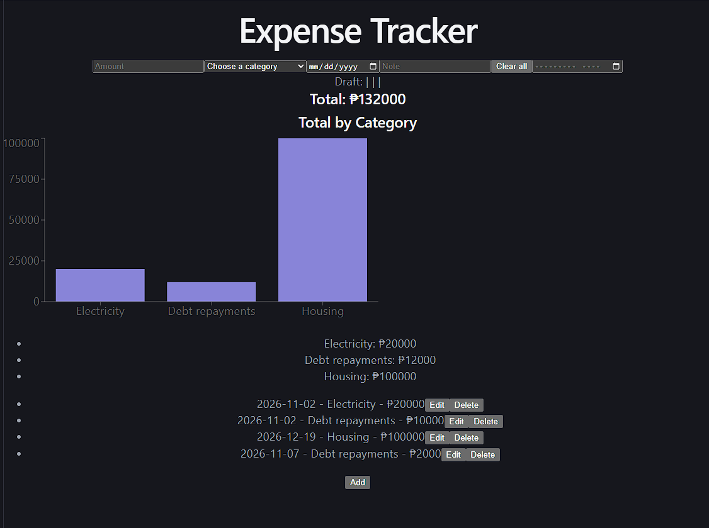

# Expense Tracker 
A personal finance management app that allows users to record, organize, and monitor their daily, monthly, and miscellaneous expenses. It helps users track where their money goes by categorizing transactions, calculating total expenses, and visualizing patterns through charts. 




## Features
  - Add expenses
  - Edit expenses
  - Delete expenses
  - Input validation with error messages
  - Month filter
  - Total and per-category totals
  - Bar chart of spending by category
  - Data saved in the browser, so it survives a refresh

## Tech Stack
 - React (Vite)
 - JavaScript
 - Recharts
 - localStorage (temporary until the backend is added)

## Run it locally

**Requirements:** [Node.js](https://nodejs.org/) 20 or newer.

1. Clone the repository:
   ```bash
   git clone https://github.com/biosargee/expense-tracker.git
   ```
2. Go into the project folder:
   ```bash
   cd expense-tracker
   ```
3. Install the dependencies:
   ```bash
   npm install
   ```
4. Start the development server:
   ```bash
   npm run dev
   ```
5. Open the link the terminal prints, usually `http://localhost:5173`.


 ## Roadmap
 1. Express backend
 2. PostgreSQL integration
 3. Live Deployment (Vercel or Netlify)
